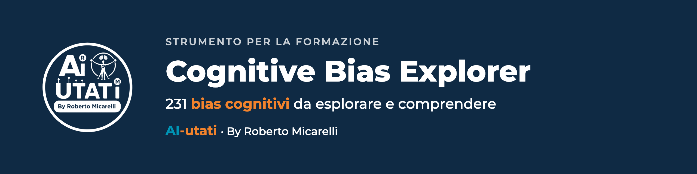

<p align="center">
  
</p>

<p align="center">
  <a href="https://ai-utati-bias-explorer.vercel.app"></a>
  
  
  
  
</p>

**Cerca un bias, capiscilo, portalo in aula.** Un'applicazione web per esplorare 231 bias cognitivi, ognuno con descrizione, tecniche per gestirlo, esempio reale, vantaggi, svantaggi e un'attività da fare con un gruppo.

## In 30 secondi

| Scheda | Dettaglio |
|---|---|
| **Cos'è** | Un dizionario interattivo dei bias cognitivi |
| **Per chi** | Formatori, coach, chi lavora sul decision-making, chi studia psicologia o economia comportamentale |
| **Come provarlo** | [Apri la demo](https://ai-utati-bias-explorer.vercel.app) |

## Cosa puoi fare

| Funzione | Come funziona |
|---|---|
| **Trovare un bias** | Elenco completo, ricerca per nome o nel testo della descrizione, filtro per tag |
| **Leggere la scheda** | Due pagine per bias: la prima con descrizione, contesto reale, vantaggi e svantaggi; la seconda con tecniche per gestirlo, attività esperienziale d'aula, fonti |
| **Passare da un bias all'altro** | Frecce avanti e indietro dalla scheda |
| **Partire dal quadro generale** | Homepage con il Cognitive Bias Codex |

## Cosa contiene ogni scheda

`Bias` · `Descrizione` · `Tecniche per gestirlo` · `Contestualizzazione nel Reale` · `Vantaggi` · `Svantaggi` · `Attività Esperienziale di Aula` · `Fonti` · `Tag`

## Per l'aula

- **Formazione aziendale:** workshop sul decision-making, partendo da un bias alla volta.
- **Coaching:** rendere visibili le distorsioni cognitive.
- **Università:** corsi di psicologia ed economia comportamentale.
- **Studio personale:** allenare il pensiero critico.

## Avvio in locale

```bash
npm install
npm run dev        # sviluppo
npm run build      # build di produzione
npm run preview    # anteprima della build
```

Serve Node.js 18 o successivo. Il progetto è già configurato per Vercel (build `npm run build`, output `dist`).

## Come è fatto

| Tecnologia | Ruolo |
|---|---|
| React 18 + TypeScript | Interfaccia |
| Tailwind CSS | Stili |
| React Router v6 | Navigazione |
| Vite | Build |

Struttura: pagine in `src/pages/` (Home, Ricerca, Dettaglio), dati in `src/data/biases.json`, filtri in `src/utils/`. Per le idee future vedi [ROADMAP.md](ROADMAP.md).

## Fonti e licenza

I contenuti sui bias sono tratti dal libro **[Gli errori della mente](https://amzn.to/3JnVYkW)** di Mondino L. e Brambilla L. (ACS, Milano, 2022), la prima enciclopedia italiana dei bias riconosciuti in letteratura.

Progetto per uso interno e didattico.

---

**AI-utati** · By Roberto Micarelli · Formatore, Coach, Consulente · [ai-utati.it](https://www.ai-utati.it) · [Scheda sul sito](https://www.ai-utati.it/risorse/cognitive-bias-explorer/) · [Tutti i progetti](https://github.com/RobertoMicarelli/brand-ai-utati)

**Provalo ora:** apri la demo, scegli un bias che riconosci nel tuo lavoro e leggi la sua attività d'aula.
